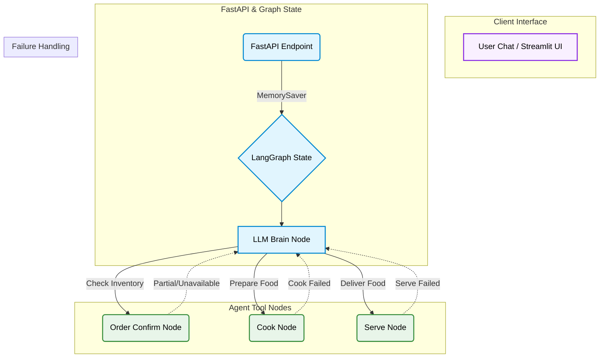

# Restaurant Agent

A multi-turn AI restaurant ordering system built with LangGraph and FastAPI.

> **Live Deployments:**
> * **Interactive API Documentation:** [restaurant-agent-oarq.onrender.com/docs](https://restaurant-agent-oarq.onrender.com/docs)
> * **Streamlit Chat Application:** [restaurants-agents.streamlit.app](https://restaurants-agents.streamlit.app/)

---

## Overview

Restaurant Agent is an autonomous conversational ordering agent powered by LangGraph state machines and Groq LLM inference. It manages complex, multi-turn dialogues, extracts customer menu requests into structured Pydantic schemas, verifies dish availability against real-time inventory, and simulates kitchen pipeline lifecycles (order confirmation, cooking, and delivery) with integrated fault tolerance and customer confirmation loops.

---

## Architecture Overview



---

## Features

| Feature | Description |
| ------- | ----------- |
| **Structured Order Extraction** | Uses Groq structured outputs via Pydantic to parse dish selections, quantities, dietary specifications, and user intent |
| **Stateful LangGraph Workflow** | Manages conversational order state using `MemorySaver`, supporting multi-turn memory and human-in-the-loop validation |
| **Inventory Verification** | Validates requested items dynamically against active menu dictionaries; handles partial orders by seeking customer confirmation |
| **Kitchen Fault Tolerance** | Simulates real-world kitchen preparation retries and exception routing across cooking and delivery stages |
| **Modular Serving Stack** | Decoupled architecture pairing a FastAPI REST backend on Render with an interactive Streamlit UI |

---

## Technology Stack

| Component | Technologies |
| :-------- | :----------- |
| **Agent Framework** | `LangGraph`, `LangChain` |
| **LLM Inference** | `Groq` API |
| **Schema Validation** | `Pydantic`, `Pydantic-Settings` |
| **API & Backend** | `FastAPI`, `Uvicorn` |
| **Frontend UI** | `Streamlit` |
| **Testing & Quality** | `pytest`, `ruff` |
| **Packaging & Containers** | `uv`, `Docker` |

---

## Project Structure

```
Restaurant-Agent/
├── app/
│   ├── config.py           # Environment and settings configuration
│   ├── graph.py            # LangGraph workflow nodes, edges, and state transitions
│   ├── main.py             # FastAPI service and chat endpoints
│   └── models.py           # Pydantic schemas for orders, dishes, and responses
├── tests/
│   └── test_scenarios.py   # Multi-turn order scenario test suite
├── streamlit_app.py        # Streamlit conversational interface
├── Dockerfile              # Production container build definition
├── pyproject.toml          # uv dependency management specification
├── render.yaml             # Render deployment configuration
└── README.md
```

---

## Setup and Installation

### Prerequisites

- Python 3.11+
- A [Groq API key](https://console.groq.com/keys)
- [`uv`](https://docs.astral.sh/uv/) installed

### 1. Clone the repository

```bash
git clone https://github.com/Shashank17singh/Restaurant-Agent.git
cd Restaurant-Agent
```

### 2. Install dependencies

```bash
uv sync
```

### 3. Configure environment variables

Create a `.env` file in the root directory:

```env
GROQ_API_KEY=your_api_key_here
```

### 4. Start the backend API

```bash
uv run uvicorn app.main:app --port 8000 --reload
```

Interactive Swagger documentation is available at `http://localhost:8000/docs`.

### 5. Start the chat interface

In a separate terminal:

```bash
uv run streamlit run streamlit_app.py
```

---

## Running the Tests

Execute automated test scenarios:

```bash
uv run pytest
```

Run static code analysis and linting:

```bash
uv run ruff check .
```

---

## Deployment

The application includes a production Docker container running as an unprivileged user:

```bash
docker build -t restaurant-agent .
docker run -p 8000:8000 -e GROQ_API_KEY=your_key restaurant-agent
```

Live deployments:
- **API Documentation:** [restaurant-agent-oarq.onrender.com/docs](https://restaurant-agent-oarq.onrender.com/docs)
- **Chat Interface:** [restaurants-agents.streamlit.app](https://restaurants-agents.streamlit.app/)

---

## Known Limitations

- Order state is persisted in-memory using `MemorySaver`; distributed horizontal scaling across multi-instance clusters requires a shared Redis or PostgreSQL checkpointer.
- Menu configurations are loaded from static dictionaries; dynamic database-backed inventory updates require external catalog webhooks.

---

## License

This project is licensed under the MIT License. See [LICENSE](LICENSE) for details.
